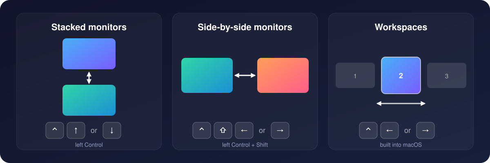

<p align="center">
  
</p>

<p align="center">
  <a href="https://github.com/trenner1/supernav/releases/latest"></a>
  
  
</p>

SuperNav brings the Pop!_OS habit of hopping around your desk with the keyboard to macOS. Hold left Control and an arrow key to jump to the next monitor. The cursor follows, and the top window there gets focus, so you can start typing straight away.

## Shortcuts

<p align="center">
  
</p>

| Keys | Action |
| --- | --- |
| <kbd>⌃ left</kbd> <kbd>↑</kbd> / <kbd>↓</kbd> | Jump to the monitor above or below |
| <kbd>⌃ left</kbd> <kbd>⇧</kbd> <kbd>←</kbd> / <kbd>→</kbd> | Jump to the monitor on the left or right |
| <kbd>⌃</kbd> <kbd>←</kbd> / <kbd>→</kbd> | Switch workspace on the current monitor (built into macOS) |

Right Control is left alone, so <kbd>⌃ right</kbd> <kbd>↑</kbd> / <kbd>↓</kbd> still opens Mission Control and App Exposé.

## Install

### Homebrew

```sh
brew tap trenner1/tap
brew trust trenner1/tap
brew install --cask supernav
```

Homebrew only installs from taps you've trusted, which is what `brew trust` does.

### Download

Grab `SuperNav.zip` from the [latest release](https://github.com/trenner1/supernav/releases/latest), unzip it and drag **SuperNav.app** into Applications.

### From source

```sh
git clone https://github.com/trenner1/supernav.git
cd supernav
make install IDENTITY=-
```

This builds `~/Applications/SuperNav.app` and adds a LaunchAgent so it starts at login. `IDENTITY=-` signs it ad hoc. If you have a code-signing certificate, pass its name instead, so macOS keeps the Accessibility permission across rebuilds.

## First launch

1. **Open it.** Release downloads from version 1.0.1 are Developer ID signed and notarized by Apple. Open SuperNav normally.
2. **Grant Accessibility.** SuperNav needs it to read keys and focus windows. Turn it on under **System Settings → Privacy & Security → Accessibility**. It starts working within a couple of seconds, with no restart needed.
3. **Start at login** (Homebrew and download installs). Add SuperNav under **System Settings → General → Login Items**.

When SuperNav is running, its icon (two side-by-side rectangles) appears in the menu bar.

Workspace switching uses macOS's own Mission Control shortcuts. Keep **Move left/right a space** enabled under **System Settings → Keyboard → Keyboard Shortcuts → Mission Control**, and **Displays have separate Spaces** on under **Desktop & Dock**.

## Arranging screens

Monitor jumps follow the macOS display arrangement by default. If that doesn't match how your screens sit on your desk:

1. Click the SuperNav menu bar icon and choose **Arrange Screens…**
2. Drag the screens into place. The hint underneath tells you which shortcut reaches each layout.
3. Click **Done**.

The layout is saved per display, so it survives reboots and replugging. **Use macOS Arrangement** in the same menu clears it.

## Uninstall

```sh
brew uninstall --cask supernav
```

For a source install, run `make uninstall` from the repo instead.
