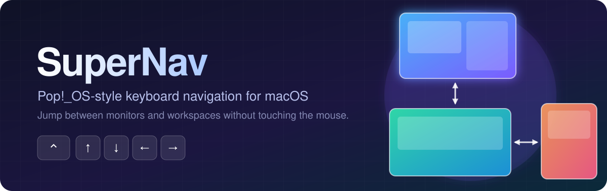

<p align="center">
  
</p>

<p align="center">
  <a href="https://github.com/trenner1/supernav/releases/latest"></a>
  
  
</p>

SuperNav brings the Pop!_OS habit of hopping around your desk with the keyboard to macOS. Hold left Control and an arrow key to jump to the next monitor. The cursor follows, and the top window there gets focus, so you can start typing straight away.

## Shortcuts

<p align="center">
  
</p>

| Keys | Action |
| --- | --- |
| <kbd>⌃ left</kbd> <kbd>↑</kbd> / <kbd>↓</kbd> | Jump to the monitor above or below |
| <kbd>⌃ left</kbd> <kbd>⇧</kbd> <kbd>←</kbd> / <kbd>→</kbd> | Jump to the monitor on the left or right |
| <kbd>⌃</kbd> <kbd>←</kbd> / <kbd>→</kbd> | Switch workspace on the current monitor (built into macOS) |

Right Control is left alone, so <kbd>⌃ right</kbd> <kbd>↑</kbd> / <kbd>↓</kbd> still opens Mission Control and App Exposé.

## Install

### Homebrew

```sh
brew tap trenner1/tap
brew trust trenner1/tap
brew install --cask supernav
```

Homebrew only installs from taps you've trusted, which is what `brew trust` does.

### Download

Grab `SuperNav.zip` from the [latest release](https://github.com/trenner1/supernav/releases/latest), unzip it and drag **SuperNav.app** into Applications.

### From source

```sh
git clone https://github.com/trenner1/supernav.git
cd supernav
make install IDENTITY=-
```

This builds `~/Applications/SuperNav.app` and adds a LaunchAgent so it starts at login. `IDENTITY=-` signs it ad hoc. If you have a code-signing certificate, pass its name instead, so macOS keeps the Accessibility permission across rebuilds.

## First launch

1. **Open it.** Release downloads from version 1.0.1 are Developer ID signed and notarized by Apple. Open SuperNav normally.
2. **Grant Accessibility.** SuperNav needs it to read keys and focus windows. Turn it on under **System Settings → Privacy & Security → Accessibility**. It starts working within a couple of seconds, with no restart needed.
3. **Start at login** (Homebrew and download installs). Add SuperNav under **System Settings → General → Login Items**.

When SuperNav is running, its icon (two side-by-side rectangles) appears in the menu bar.

Workspace switching uses macOS's own Mission Control shortcuts. Keep **Move left/right a space** enabled under **System Settings → Keyboard → Keyboard Shortcuts → Mission Control**, and **Displays have separate Spaces** on under **Desktop & Dock**.

## Arranging screens

Monitor jumps follow the macOS display arrangement by default. If that doesn't match how your screens sit on your desk:

1. Click the SuperNav menu bar icon and choose **Arrange Screens…**
2. Drag the screens into place. The hint underneath tells you which shortcut reaches each layout.
3. Click **Done**.

The layout is saved per display, so it survives reboots and replugging. **Use macOS Arrangement** in the same menu clears it.

## Uninstall

```sh
brew uninstall --cask supernav
```

For a source install, run `make uninstall` from the repo instead.

## Signed and notarized releases

Release builds require Xcode command-line tools, a paid Apple Developer Program
membership, and a **Developer ID Application** identity (certificate plus private
key) in your keychain. Check existing identities before creating another:

```sh
security find-identity -v -p codesigning
```

In Xcode, use Settings → Accounts → your team → Manage Certificates to create or
manage the identity. If Xcode reports an Account Holder role error, create the
certificate at https://developer.apple.com/account/resources/certificates/list
using a CSR from Keychain Access → Certificate Assistant → Request a Certificate
From a Certificate Authority, then import the downloaded certificate on the same
Mac. Existing certificates need their original private key; a
`.cer` download alone cannot restore that key. Import a backed-up `.p12` or use
the Mac where the identity was created when applicable. Keep default certificate
trust settings.

Store notarization credentials once in Keychain. Run this interactively, supplying
your Apple account, Developer Team ID, and an app-specific password when prompted:

```sh
xcrun notarytool store-credentials supernav-notary
```

Create an app-specific password at https://account.apple.com. Do not put passwords,
private keys, or certificate exports in this repository.

```sh
make release RELEASE_IDENTITY='Developer ID Application: Your Name (TEAMID)'
```

The release command builds a universal app, signs with hardened runtime and a
secure timestamp, submits it to Apple, waits for acceptance, staples and validates
the ticket, checks Gatekeeper, and then creates `build/release/SuperNav.zip`.
`NOTARY_PROFILE` can override the default Keychain profile. Submission results are
saved in `build/release/notarization.json`; for rejected submissions, use the ID
there with `xcrun notarytool log ID --keychain-profile supernav-notary`.

Upload only the final `SuperNav.zip` to a new GitHub release, then update the
Homebrew cask version, URL, and SHA-256 with the hash printed by the command.
Older releases before 1.0.1 are unnotarized. Accessibility permission is still
required for all versions.

## Automated GitHub releases

The `Release` workflow runs when a stable `vX.Y.Z` tag is pushed. It requires the
tag to match `CFBundleShortVersionString` in `Info.plist`, then builds the universal
app (including its macOS app icon), signs, notarizes, staples, verifies Gatekeeper,
publishes `SuperNav.zip`, and updates `trenner1/homebrew-tap` with the published
asset's SHA-256. It rejects Homebrew downgrades. Retrying a release reuses its
existing published ZIP instead of replacing it.

One-time credential setup on the Mac that holds the Developer ID private key:

```sh
./scripts/setup-actions.sh
```

The interactive script explains how to export the Developer ID identity as a
password-protected `.p12` and securely uploads it and notarization credentials to
GitHub Actions Secrets. It creates no plaintext `.env`. Keep the exported identity
and its password in a secure backup; never commit them. GitHub's documented
[macOS signing setup](https://docs.github.com/en/actions/how-tos/deploy/deploy-to-third-party-platforms/sign-xcode-applications)
uses the same temporary-keychain pattern.

Required repository secrets:

| Secret | Purpose |
| --- | --- |
| `APPLE_CERTIFICATE_P12_BASE64` | Base64 of the Developer ID certificate and private key |
| `APPLE_CERTIFICATE_PASSWORD` | Password protecting that `.p12` |
| `APPLE_ID` | Apple account used for notarization |
| `APPLE_APP_PASSWORD` | Apple app-specific password for notarization |
| `HOMEBREW_TAP_DEPLOY_KEY` | Dedicated SSH private key with write access only to the tap |

Set repository variable `APPLE_TEAM_ID` to the signing team. The tap deploy key
and team variable were configured during initial setup. The workflow imports the
identity into a temporary keychain and deletes it and temporary key files on exit.
No release secrets are used by pull-request workflows.

Before the first automated release, run the workflow from GitHub's **Actions →
Release → Run workflow**, select an existing version tag, and leave **verify_only**
enabled. This exercises signing and notarization without publishing or changing
the cask. A non-verification manual run can retry an existing release and finish
its cask update. If the cask push loses a race, rerun after checking the newer tap
commit; the workflow never force-pushes.

For each future release, update the version and increment `CFBundleVersion` in
`Info.plist`, commit and push those changes, then tag that commit:

```sh
git tag v1.0.2
git push origin v1.0.2
```

Signing certificates and Apple app-specific passwords need replacement if they
expire or are revoked. Publishing the current icon requires a new release; the
already-published 1.0.1 ZIP is left intact.
